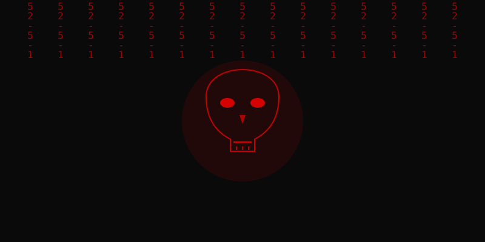
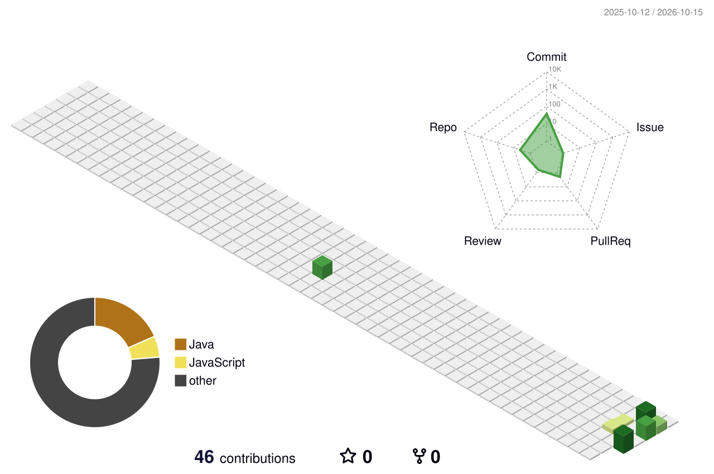

<!-- БАННЕР-ТАЙПИНГ: ВЕРХНЯЯ СТРОКА СБОЯ СИСТЕМЫ -->
<p align="center">
  
</p>

<!-- НАШ КАСТОМНЫЙ ЧЕРЕП С ЦИФРАМИ -->
<p align="center">
  
</p>

<!-- СЧЕТЧИК ПОСЕЩЕНИЙ В СТИЛЕ ТЕРМИНАЛА -->
<p align="center">
  
  <br>
  <code>[ TOTAL_SYSTEM_INFILTRATIONS ]</code>
</p>

◤◢◤◢◤◢◤◢◤◢◤◢◤◢◤◢◤◢◤◢◤◢◤◢ TERMINAL ◤◢◤◢◤◢◤◢◤◢◤◢◤◢◤◢◤◢◤◢◤◢◤◢

```text
 █▄ ▄█ █▀█ █▀█ █▀▀ █ █ █▀█ █▄ █ 
 █ ▀ █ █▄█ █▀▄ █▄▄ █▄█ █▀▄ █ ▀█ 
              [ HOST_STATUS: OVERRIDE ]
```

- 🕵️‍♂️ **Текущий статус:** Изучение архитектуры систем, автоматизация рутины и написание кода.
- 🩸 **Эстетика:** Черный фон, красный неон, сырые логи terminal, идеальный порядок в репозиториях.
- ⚡ **Директива:** `852-5-1` — код должен работать стабильно, эффективно и незаметно.

🔒 [ TECH_STACK // ДОСТУПНЫЕ_ИНСТРУМЕНТЫ ] ────────────────────────────────────────

<p align="left">
  
  
  
  
  
  
</p>

🔒 [ INFECTED_DATA // АНАЛИТИКА_СЕРВЕРА ] ────────────────────────────────────────

<p align="center">
  
  
</p>

🔒 [ ACTIVITY_MATRIX // 3D-ЛОГИ ] ───────────────────────────────────────────────

<p align="center">
  
</p>

<br>
<p align="right">
  <code>CONNECTION_CLOSED_BY_HOST... IP: 127.0.0.1 🩸</code>
</p>
