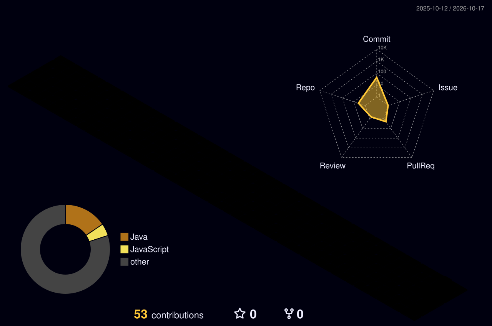

  <!-- 1. Анимированный индикатор фаервола (Banner Typing) -->
  
   
  
  <!-- 3. Лог посещений (Счётчик взломов) -->
  

 

<!-- 2. Нейро-ядро терминала (Череп и Матрица) -->

  

 

<!-- 5. Зашифрованный блок (Китайский текст) -->

  
<code>警告：权限已被强制覆写。协议 852-5-1 激活。系统不欢迎任何追踪尝试。 </code>

 

<!-- 6. Доступные инструменты (Стек технологий) -->

  

 

<!-- 7 & 8. Аналитика сервера (GitHub Stats) -->

  <table border="0">
    <tr>
      <td width="50%" align="center">
        <!-- GitHub Stats -->
        
      </td>
      <td width="50%" align="center">
        <!-- Top Languages -->
        
      </td>
    </tr>
  </table>

 

<!-- 9. Монитор времени (WakaTime) - Автоматическое обновление -->

  <!--START_SECTION:waka-->
  <!--END_SECTION:waka-->

 

<!-- 10. Мрачный 3D-город (Генерируется workflow) -->

  <!-- 3D Contribution Graph -->
  

